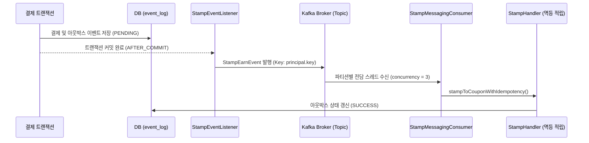

# ☕ GU Coffee (`gu-coffee`)

> Kotlin 2.1 & Spring Boot 4.0 기반의 커피 주문·결제 멀티 모듈 시스템

---

## 📌 목차
- [1. 프로젝트 개요](#1-프로젝트-개요)
- [2. 멀티 모듈 아키텍처](#2-멀티-모듈-아키텍처)
- [3. 핵심 엔지니어링 & 시스템 신뢰성 설계](#3-핵심-엔지니어링--시스템-신뢰성-설계)
- [4. 기술 스택](#4-기술-스택)
- [5. 주요 도메인 기능](#5-주요-도메인-기능)
- [6. API 엔드포인트](#6-api-엔드포인트)
- [7. 빌드 및 실행 가이드](#7-빌드-및-실행-가이드)

---

<a name="1-프로젝트-개요"></a>
## 1. 프로젝트 개요

`gu-coffee`는 프랜차이즈 주문·결제 환경을 기반으로 한 학습 및 아키텍처 탐구 프로젝트입니다.  
도메인 간 물리적 경계를 분리하고 동시성 제어, 분산 환경에서의 장애 격리 및 보상 트랜잭션을 실무 수준의 객관적 엔지니어링 관점에서 설계·검증하는 데 초점을 맞추고 있습니다.

---

<a name="2-멀티-모듈-아키텍처"></a>
## 2. 멀티 모듈 아키텍처

단일 배포 단위로 실행되지만 내부 도메인 간의 물리적·논리적 경계를 엄격히 분리한 **모듈러 모놀리스** 아키텍처를 채택했습니다.  
도메인 모듈을 중앙에 두고 **`API (core-api) ──► Domain (core-domain) ◄── DB (db-core)`** 방향으로 의존성이 수렴하는 의존성 역전 원칙(DIP)을 적용하여, 향후 특정 도메인을 독립 서비스로 분리할 수 있는 구조적 확장성을 확보했습니다.

<details>
<summary><b>모듈 구성 트리 펼치기</b></summary>

```text
gu-coffee
├── 🚀 coffee-server          # 메인 애플리케이션 실행 모듈 (Spring Boot Entry Point)
├── 🛠️ admin-api              # 관리자 REST API (메뉴/옵션 등록 및 매핑)
│
├── 🧠 core                   # 비즈니스 핵심 모듈 그룹
│   ├── core-api              # 사용자 REST API & 오케스트레이션 서비스 (core-domain에만 의존)
│   ├── core-domain           # 순수 비즈니스 모델, 영속성 포트(인터페이스), 도메인 이벤트 (외부 의존성 없음)
│   └── core-enum             # 공통 Enum 및 도메인 상수
│
├── 💾 storage                # 영속성 구현 모듈 그룹
│   └── db-core               # Spring Data JPA, QueryDSL 5.1, Entity, Repository 구현체
│
└── 🔌 support                # 공통 인프라 / 서포트 모듈 그룹
    ├── support-auth          # Principal 기반 인증/인가 객체
    ├── support-error         # 비즈니스 예외 계층 및 공통 ErrorType
    ├── support-event         # 트랜잭셔널 아웃박스 이벤트 디스패처 및 이벤트 로그
    ├── support-lock          # Redisson 기반 분산 락 및 로컬 락 추상화(LockManager)
    ├── support-logging       # 분산 추적 로깅 모듈 (예정)
    ├── support-messaging     # Kafka Producer/Consumer 설정
    ├── support-monitoring    # 프로메테우스 메트릭 모니터링 (예정)
    ├── support-pagination    # 슬라이스/오프셋 페이징 유틸리티
    ├── support-pg            # Toss Payments PG 연동 및 WebClient 클라이언트
    └── support-web           # 공통 ApiResponse 포맷, PrincipalArgumentResolver 및 Spring Web MVC 설정
```

</details>

---

<a name="3-핵심-엔지니어링--시스템-신뢰성-설계"></a>
## 3. 핵심 엔지니어링 & 시스템 신뢰성 설계

<details>
<summary><b>1. 결제 멱등성 보장 및 DB 커넥션 점유 최소화</b></summary>

- **문제 정의**: 외부 PG 승인 통신(평균 RTT 약 200ms) 구간을 DB 트랜잭션 내부에서 유지할 경우, 동시 요청 증가 시 DB 커넥션 점유 시간이 길어져 커넥션 풀 고갈 및 지연 발생.
- **해결 방안**:
  - `PaymentService.approvePayment` 메서드를 Non-Transactional로 유지.
  - 비관적 락(`SELECT ... FOR UPDATE`)과 상태 전이(`READY -> PENDING_PG`)를 담당하는 `PaymentPreparer.prepare` 구간만 별도 트랜잭션으로 최소화.
  - 외부 PG 네트워크 I/O 호출 전에 커넥션을 즉시 풀에 반환하여 커넥션 점유 시간을 수 ms 단위로 단축.

</details>

<details>
<summary><b>2. 네트워크 타임아웃 대응 단계적 복구 파이프라인</b></summary>

- **문제 정의**: 외부 PG 승인 요청 중 Read Timeout 발생 시 결제 상태 불일치(고아 결제) 발생 위험.
- **해결 방안**:
  1. **동기 조회**: 예외 포착 즉시 `paymentGatewayProcessor.getPGPayment`를 호출하여 PG사 실제 승인 여부를 실시간 확인 후, 승인 완료 시 정상 완료(`complete`) 처리.
  2. **망취소**: 미승인 상태이거나 응답 불능 시 즉시 망취소(`cancelPayment`)를 호출하여 승인 취소.
  3. **Outbox 적재**: 망취소 실패 시 트랜잭셔널 아웃박스에 `CancelEvent`를 영속화하여 스케줄러 기반 비동기 보상 트랜잭션 수행.

</details>

<details>
<summary><b>3. FOR UPDATE SKIP LOCKED 기반 분산 복구 파이프라인</b></summary>

- **문제 정의**:
  - ShedLock 기반 단일 인스턴스 배치는 서버 대수와 무관하게 1대만 순차 처리하므로 지연 결제 적체 시 복구 완료까지 오랜 시간 소요.
  - 복구 배치가 일반 고객의 주문/결제와 동일한 DB 커넥션 풀을 공유하므로 커넥션 독점 방지 필요.
- **해결 방안**:
  - 1회 처리량을 20건(`LIMIT = 20`)으로 제한하여 사용자 트래픽 영향도를 최소화.
  - 행 단위 비차단 락인 `FOR UPDATE SKIP LOCKED`를 적용하여, 다중 인스턴스 환경에서 락 경합 없이 각 서버가 잔여 고립 결제(`PENDING_PG`)를 병렬로 즉시 복구하도록 설계.

</details>

<details>
<summary><b>4. Kafka 기반 비동기 이벤트 스트리밍 파이프라인 (Transactional Outbox + Kafka + 멱등 컨슈머)</b></summary>

- **문제 정의**:
  - 인메모리 비동기 이벤트(`@Async`)는 프로세스 종료 또는 재시작 시 메모리에 머물던 이벤트가 유실될 위험이 존재.
  - 결제 완료 후 스탬프 적립 등 후속 도메인 처리를 단일 서버 스레드 풀에서만 수행하면, 대용량 트래픽 인입 시 컨슈머만 독립적으로 스케일 아웃하여 처리량을 확장하기 어려움.
- **해결 방안**:
  - **Transactional Outbox 연동**: 결제 승인 DB 트랜잭션 커밋 완료 후(`@TransactionalEventListener(phase = AFTER_COMMIT, fallbackExecution = true)`), 카프카 토픽(`coffee.stamp.earn.v1`)으로 이벤트를 비동기 발행.
  - **유저별 단일 파티션 라우팅**: 유저 식별자(`principal.key`)를 파티션 키로 지정하여, 동일 유저의 이벤트가 항상 동일 파티션에 순서대로 적재되도록 보장.
  - **멀티 파티션 병렬 소비**: 토픽 파티션 3개와 리스너 동시성(`concurrency = 3`)을 구성하여 3개의 독립 컨슈머 워커 스레드가 파티션을 1:1 전담 처리.
  - **브로커 장애 대응 복구 스케줄러**: 일시적 카프카 장애로 발행되지 못한 아웃박스 미발행 건은 복구 스케줄러가 주기적으로 재시도.
  - **EmbeddedKafka E2E 검증**: 임베디드 카프카 브로커 환경에서 브로커 기동, 파티션 할당 대기(`ContainerTestUtils`), 프로듀서 발행 및 컨슈머 수신/위임 E2E 통합 테스트 검증 완료.



</details>

<details>
<summary><b>5. 도메인 간 트랜잭션 분리 및 장애 격리</b></summary>

- **문제 정의**: 결제 완료 트랜잭션 내부에 부가 기능(스탬프 적립)이 동기로 묶여 있을 경우, 스탬프 테이블 락이나 일시적 장애로 인해 정상 승인된 결제 전체가 롤백되는 결합 문제 발생.
- **해결 방안**:
  - 결제 코어와 마케팅 리워드의 트랜잭션 수명주기를 분리.
  - `PaymentCompleter`에서 스탬프 동기 호출을 제거하고, 결제 DB 커밋 완료 후 Spring 트랜잭션 이벤트(`@TransactionalEventListener(phase = AFTER_COMMIT, fallbackExecution = true)`) 및 카프카 비동기 브릿지(`StampMessagingProducer`)를 통해 스탬프를 적립.
  - 스탬프 적립 지연/실패가 결제 성공 트랜잭션에 영향을 주지 않도록 장애 격리.
  - ArchUnit 아키텍처 테스트를 통해 모든 `TransactionalEventListener`에 `fallbackExecution = true`가 선언되어 비-트랜잭션 환경에서도 유실 없이 동작함을 지속 검증.

</details>

<details>
<summary><b>6. Redis Cache-Aside 및 캐시 스탬피드 방어</b></summary>

- **문제 정의**: 메뉴 상세 조회 시 4단계 연관 데이터 조회(Menu $\to$ MenuOptionGroup $\to$ OptionGroup $\to$ Option)로 인해 반복 호출 시 DB 부담 증가.
- **해결 방안**:
  - 단순 PK/IN 기반 조회를 유지하면서, 조립된 메뉴 상세 데이터는 Redis 기반 Cache-Aside 패턴을 구축하여 메모리에서 서빙.
  - 캐시 만료 시 동시 다발적 DB 조회가 몰리는 현상을 방어하기 위해 `@Cacheable(sync = true)` 동기화 락을 적용하여 동일 키에 대한 DB 접근을 직렬화.
  - 관리자 메뉴-옵션 매핑 수정 시 `@CacheEvict`를 통해 캐시를 즉시 무효화하여 데이터 일관성 보장.

</details>

<details>
<summary><b>7. 선착순 한정 수량 쿠폰과 Redisson 분산 락 제어</b></summary>

- **문제 정의**: 한정 수량 프로모션 쿠폰의 동시 발급 요청 시, 재고 검사(`issuedQuantity < totalQuantity`)와 차감 간 레이스 컨디션으로 인한 초과 발급 방지 필요.
- **해결 방안**:
  - **도메인 분리와 합성 구조**: 기존 쿠폰 도메인과의 무리한 상속을 배제하고, 선착순 재고 라이프사이클을 독립 전담하는 `LimitedCoupon` 모델 및 테이블을 구축. 발급 산출물은 기존 `IssuedCoupon`으로 영속화하여 기존 주문/결제 파이프라인 재사용.
  - **Redisson 분산 락**: Redis Pub/Sub 기반 `RedissonClient`를 채택하여 락 획득 대기 오버헤드를 낮추고, `LockManager` 인터페이스로 인프라를 추상화.
  - **수명주기 분리**: 트랜잭션 커밋 전에 락이 조기 해제되는 현상을 방지하기 위해, 트랜잭션 외부에서 락을 획득/해제하고 내부에서 DB 커밋까지 마치는 수명주기(`LimitedCouponService` $\to$ `LimitedCouponIssueExecutor`) 적용.
  - 1인 1매 정책은 분산 락 내부 검증 및 DB `issued_coupon`의 복합 유니크 제약조건으로 이중 방어.

</details>

<details>
<summary><b>8. 멀티스레드 동시성 회귀 테스트 자동화</b></summary>

- **문제 정의**: 락 획득 타이밍이나 트랜잭션 경계 리팩토링 시 일반 단위 테스트만으로는 동시성 버그 감지 불가.
- **해결 방안**:
  - `CountDownLatch` 기반 통합 동시성 회귀 테스트 스위트 구축:
    - **100명 동시 발급 테스트**: 30개 한정 수량 쿠폰에 100개 스레드가 동시 경합할 때 정확히 30건 성공, 70건 품절 차단(`LIMITED_COUPON_SOLD_OUT`), DB 최종 발급 30건(초과 발급 0건) 검증.
    - **1인 1매 중복 방어 테스트**: 동일 사용자의 10회 동시 요청 시 1건만 성공하고 9건은 `COUPON_ALREADY_DOWNLOADED`로 정상 차단됨을 검증.

</details>

<details>
<summary><b>9. RestDocs 기반 OpenAPI 3.0 스펙 자동화</b></summary>

- **설계**: `com.epages.restdocs-api-spec`을 파이프라인에 연결하여 RestDocs 테스트 통과 시 `openapi3.yaml`이 자동 생성되도록 구성.
- **동기화**: Gradle `copyDocs` 태스크를 통해 빌드 산출물 및 정적 웹 리소스 디렉터리에 Swagger UI 스펙이 자동 동기화되도록 연동.

</details>

---

<a name="4-기술-스택"></a>
## 4. 기술 스택

### Core & Framework
- **Kotlin 2.1.0** (admin-api 모듈 제외 Java 21)
- **Spring Boot 4.0.5**
- **Spring Data JPA**, **QueryDSL 5.1.0 (KAPT)**
- **Spring Data Redis 4.0.4**, **Redisson 3.45.0**
- **Spring for Apache Kafka 4.0.4** (Apache Kafka 3.8 KRaft)
- **Hypersistence TSID 2.1.4** (시간순 정렬 고유 식별자 PK)

### Testing & Build
- **Gradle 9.x** (Kotlin DSL Multi-Module)
- **GitHub Actions** (CI 자동화: 테스트 검증, RestDocs/OpenAPI 스펙 생성, 빌드 패키징)
- **JUnit 5**, **Mockito-Kotlin 5.4.0**, **AssertJ**
- **Spring RestDocs** (Asciidoctor 4.0.2)
- **restdocs-api-spec 0.20.1** (OpenAPI 3.0 / Swagger UI)
- **ArchUnit 1.4.0** (멀티 모듈 DIP 및 아키텍처 규칙 검증)

---

<a name="5-주요-도메인-기능"></a>
## 5. 주요 도메인 기능

- **메뉴**: 카테고리별 메뉴 목록, 상세 정보(영양성분, 알레르기 유발물질) 조회 및 관리자 메뉴/옵션 매핑
- **장바구니**: 사용자/게스트별 장바구니 생성, 옵션별 메뉴 담기, 수량 변경 및 삭제
- **주문**: 단일 메뉴 주문 및 장바구니 기반 주문서 생성 (TSID 고유 식별자 발급)
- **결제 및 PG 연동**: Toss Payments 결제 승인, 쿠폰 할인 금액 검증 및 멱등 결제 처리
- **주문 및 결제 취소**: 주문 취소 요청 시 PG사 결제 취소 연동 및 쿠폰/스탬프 롤백
- **스탬프 & 리워드 쿠폰**: 결제 완료 이벤트 기반 스탬프 자동 적립, 10개 적립 시 무료 음료 쿠폰 발급
- **선착순 한정 수량 쿠폰**: Redisson 분산 락 하에 1인 1매 검증, 원자적 재고 차감 및 실시간 소진 처리
- **매장**: Haversine 공식 기반 사용자 위치 반경 매장 검색 및 영업 정보 조회

---

<a name="6-api-엔드포인트"></a>
## 6. API 엔드포인트

<details>
<summary><b>사용자 API 목록 보기 (v1)</b></summary>

| 도메인 | HTTP Method | Endpoint | 설명 |
| :--- | :--- | :--- | :--- |
| **Health** | `GET` | `/health` | 서버 헬스 체크 |
| **Menu** | `GET` | `/v1/menus` | 카테고리별 메뉴 목록 조회 |
| | `GET` | `/v1/menus/{menuId}` | 메뉴 상세 및 옵션 목록 조회 |
| **Cart** | `GET` | `/v1/cart` | 장바구니 조회 |
| | `POST` | `/v1/cart/items` | 장바구니 아이템 담기 |
| | `PUT` | `/v1/cart/items/{cartItemId}` | 장바구니 아이템 수량 변경 |
| | `DELETE` | `/v1/cart/items/{cartItemId}` | 장바구니 아이템 삭제 |
| **Order** | `POST` | `/v1/orders` | 주문서 생성 |
| | `GET` | `/v1/orders` | 주문 목록 조회 |
| | `GET` | `/v1/orders/{orderKey}` | 단건 주문 상세 조회 |
| **Payment** | `POST` | `/v1/payment/prepare` | 결제 사전 준비 및 금액 검증 |
| | `POST` | `/v1/payment/approve` | PG 결제 승인 요청 |
| **Cancel** | `POST` | `/v1/cancel` | 주문 및 결제 취소 요청 |
| **Coupon** | `GET` | `/v1/issued-coupons` | 보유 발급 쿠폰 목록 조회 |
| | `POST` | `/v1/coupons/{couponId}/download` | 일반 쿠폰 다운로드 |
| **Limited Coupon** | `GET` | `/v1/limited-coupons/{limitedCouponId}` | 선착순 쿠폰 정보 및 잔여 수량 조회 |
| | `POST` | `/v1/limited-coupons/{limitedCouponId}/issue` | 선착순 쿠폰 발급 (분산 락) |
| **Stamp** | `GET` | `/v1/stamps` | 사용자 스탬프 적립 현황 조회 |
| | `GET` | `/v1/stamps/histories` | 스탬프 히스토리 내역 조회 |
| **Store** | `GET` | `/v1/stores` | 위치 반경 기반 매장 검색 |

</details>

<details>
<summary><b>관리자 API & 문서 스펙 엔드포인트 보기</b></summary>

#### 관리자 API (`/admin/v1`)
| 도메인 | HTTP Method | Endpoint | 설명 |
| :--- | :--- | :--- | :--- |
| **Menu** | `POST` | `/admin/v1/menu` | 신규 메뉴 등록 |
| **Option Group** | `POST` | `/admin/v1/menu/option-group` | 옵션 그룹(온도, 사이즈 등) 등록 |
| **Option** | `POST` | `/admin/v1/menu/option` | 세부 옵션(HOT/ICE, 샷 추가 등) 등록 |
| **Mapping** | `POST` | `/admin/v1/menu/menu-option-group` | 메뉴에 옵션 그룹 매핑 |
| | `PUT` | `/admin/v1/menu/{menuId}/option-groups` | 메뉴-옵션 그룹 매핑 일괄 변경 (`@CacheEvict`) |

#### 문서 스펙
| 문서 종류 | HTTP Method | Endpoint | 설명 |
| :--- | :--- | :--- | :--- |
| **Swagger UI / Spec** | `GET` | `/docs/openapi3.yaml` | RestDocs 기반 자동 추출 OpenAPI 3.0 스펙 |
| **RestDocs HTML** | `GET` | `/docs/index.html` | Spring RestDocs 정적 HTML 문서 |

</details>

---

<a name="7-빌드-및-실행-가이드"></a>
## 7. 빌드 및 실행 가이드

### 로컬 개발 인프라 및 서버 실행
MySQL 8.0, Redis 7.x, Kafka 3.8(KRaft) 컨테이너를 기동하고 `local-dev` 프로파일로 서버를 실행합니다.

```bash
# 1. 인프라 기동 + 헬스체크 대기 + 로컬 서버 원클릭 실행 (profile: local-dev)
./local-run.sh
# (또는 make run)

# 2. 인프라 컨테이너(MySQL, Redis, Kafka)만 실행할 때
./local-run.sh --infra-only
# (또는 make up / ./gradlew composeUp)

# 3. 로컬 인프라 컨테이너 종료
./local-stop.sh
# (또는 make down / ./gradlew composeDown)

# 4. 볼륨 데이터를 포함하여 인프라 초기화 종료
./local-stop.sh --clean
# (또는 make clean)
```

### 테스트 실행
```bash
# 전체 테스트 실행
./gradlew test

# Kafka 메시징 파이프라인 E2E 통합 테스트
./gradlew :core:core-api:test --tests "com.coffee.gu.stamp.messaging.*"

# 선착순 쿠폰 분산 락 및 동시성 테스트
./gradlew :core:core-api:test --tests "*LimitedCoupon*"

# 결제 FOR UPDATE SKIP LOCKED 복구 파이프라인 테스트
./gradlew :core:core-api:test --tests "com.coffee.gu.payment.*"

# ArchUnit 아키텍처 규칙 검증
./gradlew :coffee-server:test
```

### 로컬 결제(Toss PG) 및 Kafka 파이프라인 수동 검증

<details>
<summary><b>Toss 결제창 연동 및 스탬프·쿠폰 비동기 발급 확인 방법 (클릭하여 펼치기)</b></summary>
<br>

외부 PG(토스페이먼츠)는 프론트엔드 결제창 인증이 선행되어야 백엔드 결제 승인(`POST /v1/payments/confirm`)이 가능합니다. 로컬 환경에서 주문 생성부터 PG 결제 승인, Outbox 기록, Kafka 메시지 발행·소비, 리워드 쿠폰 자동 발급까지의 전체 흐름은 내장된 테스트 페이지(`/payment-test`)와 Swagger UI를 통해 검증할 수 있습니다.

#### 1. 사전 준비 (인프라 기동 및 Kafka 토픽 실시간 모니터링)
`./local-run.sh`로 서버를 실행한 뒤, 별도 터미널에서 아래 명령어를 실행해 두면 `coffee.stamp.earn.v1` 토픽으로 유입되는 파티션 키(`userKey`)와 JSON 페이로드를 실시간으로 확인할 수 있습니다.

```bash
docker exec -it gu-coffee-kafka /opt/kafka/bin/kafka-console-consumer.sh \
  --bootstrap-server localhost:9092 \
  --topic coffee.stamp.earn.v1 \
  --from-beginning \
  --property print.key=true \
  --property key.separator=" : "
```

#### 2. 주문·결제 생성 및 토스 결제창 인증 (`http://localhost:8080/payment-test`)
브라우저에서 `http://localhost:8080/payment-test`에 접속한 뒤 아래 두 가지 방식 중 하나로 진행합니다.

- **방식 1 (화면 내 자동 생성)**:
  1. 사용자 ID(`U1`)와 주문 수량(`10`잔, 45,000원)을 확인하고 **`[① 백엔드 주문 + 결제 자동 생성]`** 버튼을 클릭합니다.
  2. 내부적으로 `POST /v1/orders` $\to$ `GET /v1/orders/{orderKey}/checkout` $\to$ `POST /v1/payments`가 호출되며 하단 입력란에 생성된 `orderKey`와 결제 금액이 자동으로 채워집니다.
  3. **`[② 토스 결제창 열기 (카드 결제)]`** 버튼을 눌러 테스트 카드 인증을 진행합니다.
- **방식 2 (Swagger UI 직접 호출 후 연동)**:
  1. Swagger UI에서 인증 헤더(`Gu-Coffee-com.coffee.gu.Principal-Id: U1`, `Gu-Coffee-com.coffee.gu.Principal-Type: USER`)를 포함하여 `POST /v1/orders`와 `POST /v1/payments`를 호출합니다.
  2. 응답받은 `orderKey`를 `/payment-test` 화면의 주문 키 입력란에 붙여넣으면 체크아웃 금액이 자동으로 동기화됩니다.
  3. **`[② 토스 결제창 열기 (카드 결제)]`** 버튼을 눌러 테스트 카드 인증을 진행합니다.

#### 3. 결제 최종 승인 및 Kafka 이벤트 발행 (`/payment-success.html` 또는 Swagger UI)
토스 결제창 인증이 완료되면 `/payment-success.html?paymentKey=...&orderId=...&amount=...`로 리다이렉트됩니다.

- 화면의 **`[① 결제 최종 승인 요청 (POST /v1/payments/confirm)]`** 버튼을 클릭하거나, 화면에 표시된 `orderId`(`orderKey`)를 복사하여 Swagger UI의 `POST /v1/payments/confirm` API를 호출합니다.
- 승인 완료 시 백엔드에서 다음 작업이 순차 실행됩니다:
  1. `PaymentCompleter`: 결제 상태를 `SUCCESS`, 주문 상태를 `PAID`로 변경하고 `PaymentApprovedEvent` 발행
  2. `StampRewardManager`: 음료 수량(10잔)만큼 스탬프를 적립하고 `event_log` 테이블에 `StampEarnEvent` 기록 (`PUBLISHED`)
  3. `StampMessagingProducer`: `AFTER_COMMIT` 단계에서 Kafka `coffee.stamp.earn.v1` 토픽으로 메시지 비동기 전송
  4. `StampMessagingConsumer`: 메시지 수신 후 멱등성(`eventId`) 검증 $\to$ 누적 스탬프 10개 차감(`USE`) $\to$ 무료 음료 쿠폰(`couponId = 3`) 자동 발급 $\to$ Outbox 상태를 `SUCCESS`로 갱신

#### 4. 결과 확인 방법

1. **웹 화면 또는 API 응답으로 확인**:
   - `/payment-success.html` 화면의 **`[② 스탬프 잔여 개수 & 발급된 쿠폰 조회]`** 버튼을 클릭합니다. (또는 Swagger에서 `GET /v1/stamps`, `GET /v1/stamps/history`, `GET /v1/issued-coupons`를 호출합니다.)
   - **기대 결과**:
     - `currentStampCount`: `{"count": 0}` (10개 적립 직후 리워드 전환으로 10개 차감 완료)
     - `stampHistory`: `+10 (EARN)` 적립 이력과 `-10 (USE)` 사용 이력 총 2건 조회
     - `issuedCoupons`: `[스탬프완성] 아메리카노 1잔 무료 교환권` (`FREE_DRINK`, `ACTIVE`) 발급 확인
2. **Kafka 콘솔 컨슈머 터미널 확인**:
   - 1번 단계에서 띄워둔 터미널에 `U1 : {"userKey":"user-100","storeId":1,"earnedCount":10,"eventId":"..."}` 형태의 메시지가 출력되었는지 확인합니다.
3. **MySQL Outbox 테이블(`event_log`) 상태 확인**:
   - `SELECT event_id, event_type, is_published, status, retry_count FROM event_log WHERE event_type = 'STAMP_EARN';` 조회 시 `is_published = 1`, `status = 'SUCCESS'`로 최종 전이되었는지 확인합니다.

</details>

### GitHub Actions CI 파이프라인
`main` 브랜치 푸시 및 `main` 대상 풀 리퀘스트 생성 시 자동으로 다음 파이프라인이 실행됩니다:
1. **JDK 21 & Gradle 캐싱 환경 구성**
2. **전체 단위·통합·ArchUnit 테스트 검증** (`./gradlew test --continue`)
3. **RestDocs HTML & OpenAPI 3.0 스펙 생성 검증** (`./gradlew :core:core-api:asciidoctor :core:core-api:openapi3`)
4. **BootJar 최종 패키징 검증** (`./gradlew :coffee-server:bootJar`)
5. **실패 시 테스트 리포트, 성공 시 API 문서 아티팩트 자동 보관**

